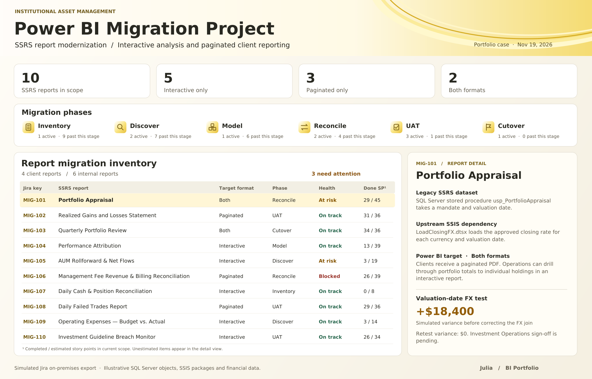
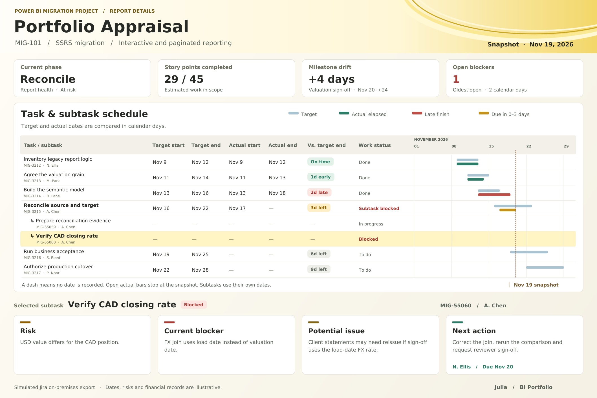

# Power BI Migration Project

An institutional asset manager is migrating ten SSRS reports to Power BI. Some users need a paginated client statement. Others need to investigate the positions behind the same total. This portfolio case shows how to choose a target format, track delivery and decide whether a migrated report is ready for sign-off. All project records and financial figures are simulated.

[Read the one-page case study](Power_BI_Migration_Case_Study.pdf) · [Download the interactive walkthrough](Asset_Manager_Report_Migration.html?raw=1) · [Explore the editable Power BI project](native/ReportMigration)

## Follow one report from inventory to sign-off

1. Download the HTML walkthrough and open the saved file in a browser. Select **MIG-101 · Portfolio Appraisal**.
2. Compare each task’s target and actual dates. At the November 19 snapshot, the reconciliation task has three calendar days left, yet its CAD closing-rate check is already blocked. Select the subtask to see the risk, blocker and next action.
3. Scroll to **Valuation reconciliation**. The original join applies a load-date rate of USD 0.77 per CAD to a CAD 920,000 holding. The approved valuation-date rate is USD 0.75 per CAD. The two-cent difference overstates the portfolio by **USD 18,400**.
4. Select **Retest approved closing FX**. The difference falls to **USD 0**. The next decision belongs to Investment Operations, which reviews the evidence before sign-off.

## Explore the implementation

| Artifact | What to inspect |
| --- | --- |
| [Migration inventory](Report_Migration_Inventory.xlsx) | Report purpose, target format, upstream logic, acceptance criteria and task estimates |
| [Editable Power BI project](native/ReportMigration) | The migration tracker’s semantic model, DAX measures, report definitions and drill-through bindings |
| [Source-query benchmark](source_sql/benchmark.py) and [recorded results](source_sql/benchmark_results.json) | A reproducible SQLite comparison on 288,000 synthetic rows, with matching daily totals and position counts |

To open the native tracker, download the project files together, keep the folder structure intact and open `ReportMigration.pbip` in Windows Power BI Desktop. Refresh the model, then right-click a Jira key and select **Drill through → Epic details**. The PNGs show the design references. The HTML walkthrough runs offline. Desktop rendering, model refresh and service response times still require validation in the target environment.
